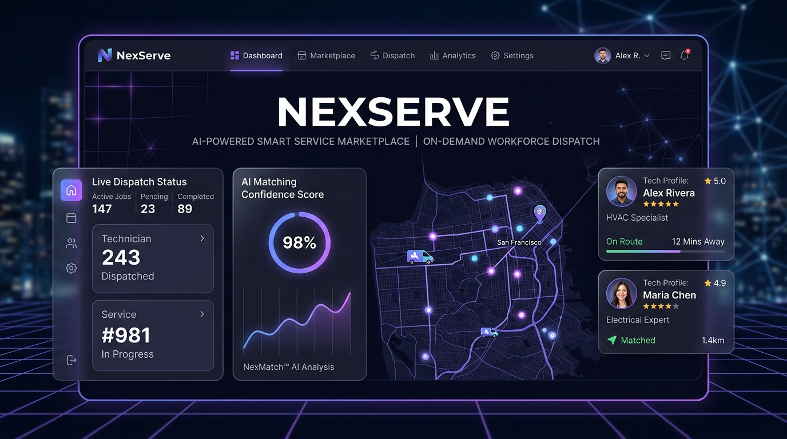
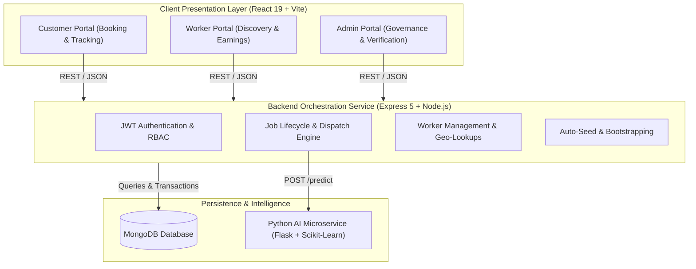

# NexServe

<p align="center">
  <strong>Next-Generation AI-Driven On-Demand Service & Smart Workforce Dispatch Platform</strong>
</p>

<p align="center">
  
  
  
  
  
  
</p>

<p align="center"></p>

---

## 📌 Executive Overview

**NexServe** is an enterprise-grade, full-stack on-demand service marketplace and automated workforce orchestration platform. Designed to bridge the gap between consumers requiring skilled household and technical services and pre-vetted service professionals, NexServe pairs an intuitive user experience with an asynchronous AI classification engine and geospatial dispatch logic.

From natural language service request interpretation to real-time technician matching, OTP-authenticated task lifecycles, and supervisory administration dashboards, NexServe delivers a production-ready ecosystem.

---

## 🏗️ System Architecture

NexServe is organized into three decoupled layers communicating via authenticated REST APIs:



---

## ⚡ Core Capabilities

- **Natural Language AI Categorization**: Evaluates raw service descriptions using trained multi-output scikit-learn models to instantly infer service category, exact skill requirements, and difficulty rating.
- **Intelligent Dispatch Engine**: Pairs incoming requests against qualified, verified, and nearby service professionals with proximity-based matching algorithms.
- **Tri-Role RBAC Portals**:
  - **Customers**: Request instant or scheduled jobs, track arrival, manage payment, and securely verify technician arrival with dynamic OTP codes.
  - **Workers / Technicians**: Accept nearby job alerts, track routing, submit completion, monitor daily earnings, and upload KYC credentials.
  - **Administrators**: Verify worker profiles, inspect system throughput, maintain categories, and oversee dispute reports.
- **Resilient Fallback Design**: Backend automatically falls back gracefully if the AI prediction service is unreachable, ensuring uninterrupted job posting.
- **Automated Bootstrapping**: Automatically seeds preconfigured default admin credentials and standard service categories upon initial startup.

---

## 💻 Tech Stack Overview

| Tier | Technologies | Highlights |
| :--- | :--- | :--- |
| **Frontend** | React 19, Vite, React Router DOM 7, Lucide Icons, Axios | Lightning fast HMR, reactive state management, glassmorphic dark theme |
| **Backend** | Node.js, Express 5, Mongoose, JWT, BcryptJS, CORS | Modular MVC structure, centralized error interceptors, strict validation |
| **AI Service** | Python 3, Flask, Scikit-learn, Joblib, Pandas | Serialized lightweight NLP classifiers (`category_model`, `skill_model`, `difficulty_model`) |
| **Database** | MongoDB 6.0+ | Document store with flexible geospatial schemas and atomic job status transitions |
| **DevOps / Tooling** | Git, Postman, Vite Preview, ESLint | Clean environment isolation, multi-service configuration |

---

## 📂 Repository Structure

```text
NexServe/
├── ai-service/               # Python NLP & Job Classification Microservice
│   ├── data/                 # Training dataset (jobs.csv)
│   ├── models/               # Serialized ML models (.pkl)
│   ├── app.py                # Flask REST prediction API
│   ├── train_model.py        # Model training script
│   ├── requirements.txt      # Python dependencies
│   └── .env.example          # Environment template for AI service
├── backend/                  # Core Node.js / Express API Service
│   ├── config/               # Database connection logic
│   ├── controllers/          # Route controllers (Auth, Job, Worker, Admin)
│   ├── middleware/           # JWT & RBAC middleware
│   ├── models/               # Mongoose schemas (User, Worker, Job, Admin, etc.)
│   ├── routes/               # Modular Express API endpoints
│   ├── services/             # Dispatch, AI client, Notification, Location logic
│   ├── utils/                # Token generation, OTP, skill mappings
│   ├── server.js             # Entrypoint & DB seed orchestrator
│   └── .env.example          # Environment template for backend
├── frontend/                 # Client React SPA (Vite)
│   ├── public/               # Public assets and icons
│   ├── src/
│   │   ├── components/       # Reusable UI widgets & layout wrappers
│   │   ├── context/          # Authentication & user session context
│   │   ├── pages/            # View pages (Customer, Worker, Admin, Auth)
│   │   ├── routes/           # Protected routing configuration
│   │   └── services/         # Axios API clients
│   └── .env.example          # Environment template for frontend
├── docs/
│   └── assets/               # Visual project assets and preview banners
├── .gitignore                # Production-grade Git ignore definitions
├── .env.example              # Master environment configuration guide
└── README.md                 # Project documentation
```

---

## 🚀 Local Setup & Installation

### Prerequisites

Ensure the following runtimes and tools are installed:
- **Node.js**: v18.0.0 or higher
- **npm**: v9.0.0 or higher
- **Python**: v3.9 or higher
- **MongoDB**: Local instance running on port `27017` or MongoDB Atlas URI

---

### 1. Backend Service Setup

```bash
# Navigate to the backend directory
cd backend

# Install dependencies
npm install

# Configure environment variables
cp .env.example .env

# Start in development mode (with hot-reload via nodemon)
npm run dev

# Alternatively, run for production
npm start
```
*The backend API will run on `http://localhost:5000`.*

---

### 2. AI Classification Microservice Setup

```bash
# Navigate to the ai-service directory
cd ai-service

# (Optional but recommended) Create and activate a virtual environment
python -m venv .venv
# On Windows:
.venv\Scripts\activate
# On Linux/macOS:
# source .venv/bin/activate

# Install required packages
pip install -r requirements.txt

# (Optional) Retrain models if datasets are updated
python train_model.py

# Configure environment variables
cp .env.example .env

# Start the Flask microservice
python app.py
```
*The AI service will run on `http://localhost:8000`.*

---

### 3. Frontend Client Setup

```bash
# Navigate to the frontend directory
cd frontend

# Install dependencies
npm install

# Configure environment variables
cp .env.example .env

# Start the Vite development server
npm run dev
```
*Access the web application at `http://localhost:5173`.*

---

## ⚙️ Environment Variables Reference

### Backend (`backend/.env`)

| Variable | Required | Default / Example | Purpose |
| :--- | :---: | :--- | :--- |
| `PORT` | No | `5000` | Port on which Express server listens |
| `MONGO_URI` | **Yes** | `mongodb://127.0.0.1:27017/nexserve` | Connection string for MongoDB |
| `JWT_SECRET` | **Yes** | `replace-with-a-long-random-secret` | Cryptographic secret for signing JWTs |
| `AI_SERVICE_URL`| No | `http://localhost:8000` | Address of Python AI classification service |
| `ADMIN_EMAIL` | No | `admin@nexserve.local` | Default administrator account seeded on startup |
| `ADMIN_PASSWORD`| No | `admin123` | Default administrator password |
| `CORS_ORIGIN` | No | `http://localhost:5173` | Allowed origins (comma-separated for multi-domain) |

### Frontend (`frontend/.env`)

| Variable | Required | Default / Example | Purpose |
| :--- | :---: | :--- | :--- |
| `VITE_API_URL` | **Yes** | `http://localhost:5000/api` | Base URL pointing to the Backend REST API |

### AI Microservice (`ai-service/.env`)

| Variable | Required | Default / Example | Purpose |
| :--- | :---: | :--- | :--- |
| `PORT` | No | `8000` | Port for Flask application |
| `FLASK_DEBUG` | No | `0` | Enable debug mode during local training/testing |

---

## 📡 API Endpoint Overview

| Module | Method | Endpoint | Description | Access |
| :--- | :---: | :--- | :--- | :--- |
| **Auth** | `POST` | `/api/auth/register` | Register customer or worker | Public |
| **Auth** | `POST` | `/api/auth/login` | Authenticate user & issue JWT | Public |
| **Auth** | `POST` | `/api/auth/admin/login` | Administrator authentication | Public |
| **Jobs** | `POST` | `/api/jobs` | Create a new job request | Customer |
| **Jobs** | `GET` | `/api/jobs/:id` | Fetch specific job details | Authenticated |
| **Jobs** | `POST` | `/api/jobs/:id/verify-otp` | Verify technician arrival via OTP | Worker |
| **Workers** | `GET` | `/api/workers/available-jobs`| List pending jobs nearby | Worker |
| **Workers** | `PUT` | `/api/workers/status` | Toggle worker active/busy availability | Worker |
| **Admin** | `GET` | `/api/admin/metrics` | System analytics and KPIs | Admin |
| **Admin** | `PUT` | `/api/admin/verify-worker` | Approve or reject technician verification | Admin |
| **AI** | `POST` | `/predict` *(Port 8000)* | Classify category, skill, & difficulty | Internal Service |

---

## 🔒 Security & Best Practices

- **Role-Based Access Control**: Route-level JWT verification enforces separation between Customers, Technicians, and System Administrators.
- **Secure Secret Handling**: Environment files are strictly excluded from version control via standard `.gitignore` rules.
- **Password Protection**: Passwords securely hashed with Bcrypt (salt rounds: 10).
- **Graceful Failure Isolation**: The Node.js API operates resiliently with fallback logic if external AI microservices become unavailable.

---

## 📄 License

This project is licensed under the [MIT License](LICENSE).
